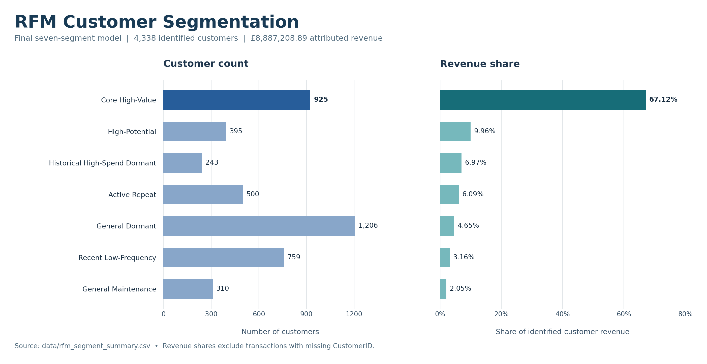
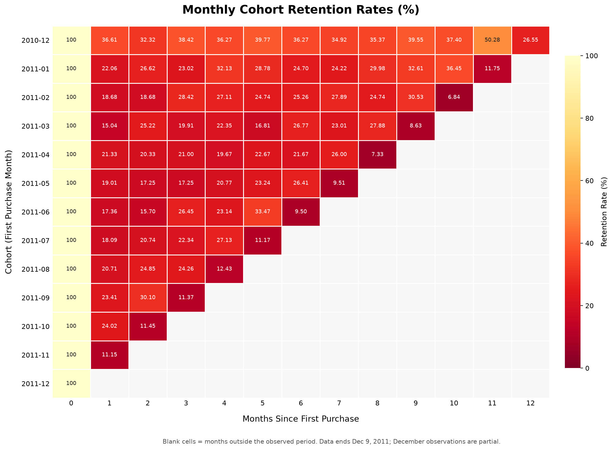
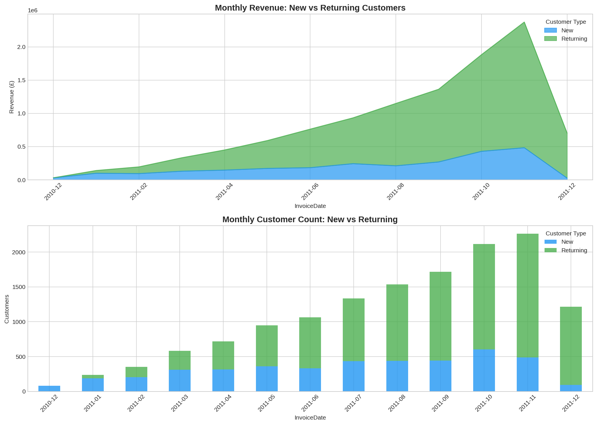
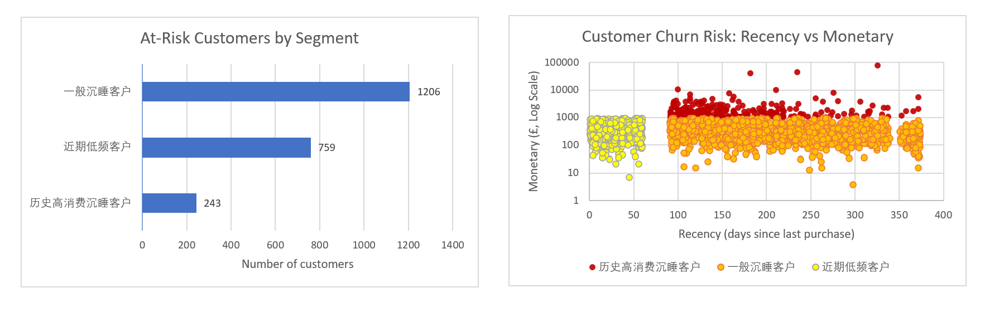
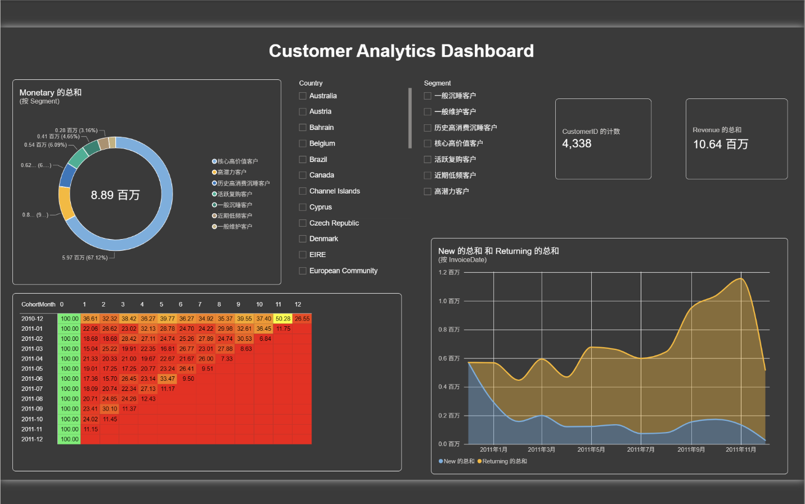

# Customer Analytics: Customer Segmentation, Retention & Revenue Analysis

**Author:** Wei  
**Tech stack:** Python (pandas, NumPy, matplotlib, seaborn) · MySQL / SQL · Power BI · Excel  
**Dataset:** UCI Online Retail Dataset  
**Analysis period:** December 1, 2010 – December 9, 2011  
**Focus:** Data quality · Sales performance · RFM segmentation · Cohort retention · Revenue analysis

## Project Overview

This project analyzes historical e-commerce transactions to understand purchasing behavior, identify valuable customer groups, evaluate repeat purchasing, and highlight potential retention opportunities. It combines Python-based preparation and segmentation, MySQL sales analysis, and a Power BI dashboard.

The analysis addresses five business questions:

- Who are the most valuable customers, and how concentrated is their spending?
- How do revenue, order volume, and average order value vary over time?
- How often do customers purchase again after their first recorded purchase?
- Which previously valuable customers may need re-engagement?
- How much sales revenue can be connected to identified customers?

> **Data-scope note:** The transaction-level sales dataset and the identified-customer dataset serve different purposes. Their totals must not be compared without accounting for transactions with missing CustomerIDs.

## 1. Data Preparation and Quality Assessment

Data preparation included checking missing values and duplicate records; investigating cancellations, negative quantities, and nonpositive prices; and separating transactions with identifiable customers from transactions without a CustomerID. Row counts and revenue were reconciled across the resulting files.

### Validated sales metrics

| Metric | Result |
|---|---:|
| Sales transaction lines | 524,878 |
| Distinct invoices | 19,960 |
| Identifiable customers | 4,338 |
| Total sales | £10,642,110.80 |
| Average order value | £533.17 |

The sales dataset retains records for broader sales analysis. Customer-level RFM and retention analysis use transactions attributable to an identified customer.

## 2. Sales Performance Analysis (SQL)

MySQL queries were used to calculate sales and order totals, monthly revenue, month-over-month changes, average order value, and top customers by spending.

**November 2011** had the highest monthly sales total among the observed full months:

| November 2011 metric | Value |
|---|---:|
| Sales | £1,503,866.78 |
| Orders | 2,769 |
| Average order value | £543.11 |

Compared with October 2011, November sales rose by approximately **30.6%** and order count by **35.7%**, while average order value declined by approximately **3.8%**. The increase was therefore associated primarily with higher order volume, not a higher average spend per order.

*The dataset ends on December 9, 2011, so December 2011 is not a complete comparison month.*

## 3. RFM Customer Segmentation

RFM describes customers using:

- **Recency (R):** Days since the most recent recorded purchase.
- **Frequency (F):** Number of distinct purchase invoices.
- **Monetary (M):** Total identified-customer spending.

The final workflow scores each measure from 1 to 5 and assigns **4,338 customers** to **seven business-oriented segments**.

| Segment | Customers | Share of identified-customer spending |
|---|---:|---:|
| Core High-Value Customers | 925 | 67.12% |
| High-Potential Customers | 395 | 9.96% |
| Historical High-Spend Dormant Customers | 243 | 6.97% |
| Active Repeat Customers | 500 | 6.09% |
| General Dormant Customers | 1,206 | 4.65% |
| Recent Low-Frequency Customers | 759 | 3.16% |
| General Maintenance Customers | 310 | 2.05% |
| **Total** | **4,338** | **100.00%** |

**Identified-customer spending:** £8,887,208.89.

**Key insight:** The 925 core high-value customers represent approximately **21.32% of identifiable customers** but account for **67.12% of their spending**. Retaining these customers is a high-priority opportunity.



## 4. Cohort Retention Analysis

Customers are grouped by their **first recorded purchase month**. Month-1 retention is the percentage of a cohort that purchased again in the following calendar month; later columns track subsequent calendar months.

### Selected Month-1 retention results

| First-purchase cohort | Month-1 retention |
|---|---:|
| December 2010 | 36.61% |
| January 2011 | 22.06% |
| February 2011 | 18.68% |
| March 2011 | 15.04% |
| April 2011 | 21.33% |
| May 2011 | 19.01% |
| November 2011 | 11.15% |

Several cohorts have Month-1 retention below 25%, suggesting opportunities to improve early repeat purchasing. The December 2010 cohort reaches 36.61%, higher than several later cohorts; the analysis alone does not establish *why*.

**Observation-window limitation:** The dataset ends on December 9, 2011. Rates involving December 2011 have a partial month of observation and should not be compared uncritically with complete months. Blank cells represent months outside the observed period, **not zero retention**.



## 5. Revenue Structure and Reconciliation

Overall sales include transactions that cannot be assigned to individual customers. The reconciliation separates these records before interpreting customer-level spending.

| Revenue scope | Amount |
|---|---:|
| Overall sales | £10,642,110.80 |
| Identified-customer sales / RFM spending | £8,887,208.89 |
| Unidentified-customer sales | £1,754,901.91 |

The reconciliation report identifies **132,186 sales lines** without a CustomerID (**25.18%** of sales lines), accounting for approximately **16.49%** of total sales. The identified-customer dataset contains **392,692 sales lines**, representing approximately **83.51%** of overall sales revenue. These row counts and amounts reconcile with the full sales dataset.

This distinction matters: treating £8.89M as the company's *entire* revenue would understate the £10.64M sales total.

The separate visualization below examines **new versus returning customer revenue among identified customers only**. It excludes transactions without a CustomerID and therefore represents a different breakdown from the *identified versus unidentified* customer reconciliation above; it should not be interpreted as a decomposition of overall sales.



## 6. Re-engagement Opportunity Exploration

The updated exploratory visualization highlights three RFM segments for closer retention and win-back attention. The counts below match the corresponding segments in Section 3:

| RFM segment | Customers |
|---|---:|
| General Dormant Customers | 1,206 |
| Recent Low-Frequency Customers | 759 |
| Historical High-Spend Dormant Customers | 243 |
| **Total shown** | **2,208** |

**Interpretation:** These are three of the seven existing RFM segments, not separate churn-model classes. The chart's "at-risk" framing is descriptive: it summarizes historical purchase behavior and does not predict which customers will churn. Historical High-Spend Dormant Customers may be candidates for win-back outreach, while Recent Low-Frequency Customers may warrant second-purchase engagement. Validate customer eligibility and campaign rules before operational use.



## 7. Business Recommendations

1. **Protect core high-value customers.** Test personalized loyalty benefits and proactive service for the customers contributing most identified-customer spending.
2. **Encourage a second purchase.** Test post-purchase follow-ups, relevant recommendations, and targeted incentives during the first month after acquisition.
3. **Re-engage formerly valuable customers.** Prioritize dormant high-spend customers for carefully measured win-back campaigns.
4. **Improve CustomerID capture.** Investigate the 132,186 unidentified sales lines to increase the coverage of future customer-level analysis.
5. **Monitor comparable cohorts.** Use consistent observation windows and separate partial-month observations when evaluating retention initiatives.

These are **recommendations from descriptive analysis**. Their effects have not yet been established by controlled experiments.

## 8. Power BI Dashboard



The saved report `Customer_Analytics_v2.pbix` presents customer segmentation, segment and country filters, sales metrics, cohort retention, and new-versus-returning revenue trends.

- **Overall sales card:** approximately £10.64M across the sales dataset.
- **Identifiable customers:** 4,338.
- **RFM spending:** approximately £8.89M for identified customers.
- **Cross-filter check:** Selecting the core high-value segment shows **925 customers** and approximately **£5.97M** of spending in the linked sales visual.

The cohort and monthly new-versus-returning revenue graphics use separate summarized tables; they represent overall trends and do not necessarily respond to the RFM segment slicer.

Open the PBIX in **Power BI Desktop**. The saved report can be viewed without rerunning Python, but **refreshing** its data may require updating local file paths in Power Query and supplying source CSV files that are not included in this lightweight repository.

## 9. Repository Structure

```text
customer-analytics-portfolio/
├── README.md
├── requirements.txt
├── .gitignore
├── Customer_Analytics_v2.pbix
├── prepare_data.py
├── check_data.py
├── clean_data.py
├── reconcile_sales.py
├── rfm_analysis.py
├── rfm_scoring.py
├── rfm_segmentation.py
├── create_cohort_retention.py
├── create_monthly_revenue_by_type.py
├── update_cohort_heatmap.py
├── sql/                         # MySQL 8 sales and customer analysis scripts
├── data/                        # Selected, compact derived outputs
│   ├── rfm_customer_summary.csv
│   ├── rfm_scored.csv
│   ├── rfm_segmented.csv
│   ├── rfm_segment_summary.csv
│   ├── cohort_retention.csv
│   ├── monthly_revenue_by_type.csv
│   └── reconciliation_report.csv
├── visualizations/              # Final chart images
└── output/                      # Executive summary
    └── executive_summary.txt
```

The folder structure reflects the **portfolio subset**, not the complete working-data archive. The original transaction files and some intermediate/diagnostic outputs remain outside this repository.

## 10. How to Run

### A. Install Python dependencies

Install Python 3 and run the following command from the repository folder:

```powershell
py -m pip install -r requirements.txt
```

The dependency list is intended to cover the included Python analysis scripts. MySQL is a separate installation; database connector dependencies may be needed if using Python-based import scripts from the full working project.

### B. Inspect the included results

The compact CSV files in `data/` are already generated. You can review the RFM results, retention matrix, monthly revenue breakdown, and reconciliation report without recreating the full transaction pipeline.

For example, to regenerate the cohort heatmap **from the provided retention CSV**, run:

```powershell
py update_cohort_heatmap.py
```

This writes a chart to `visualizations/` based on `data/cohort_retention.csv`; close any image viewer that locks the destination file before running if needed.

### C. Reproduce the full data pipeline (additional setup required)

1. Obtain the **UCI Online Retail Dataset** from its original dataset provider.
2. Place the source workbook / transaction files at the paths expected by the relevant scripts, or update those paths locally.
3. Review each script's required inputs and outputs before running the preparation, cleaning, validation, RFM, and cohort workflows.
4. If reproducing the database analysis, install **MySQL 8**, import the required cleaned transaction CSV into an appropriately configured local database, then execute the SQL scripts.
5. Open `Customer_Analytics_v2.pbix` in Power BI Desktop; if you refresh it, update source paths in Power Query to your local file locations.

**Reproducibility scope:** This repository intentionally omits large transaction CSVs and some intermediate inputs. Consequently, **not every script can run end-to-end immediately after a clone**. The supplied results and visualizations can be inspected independently; full regeneration requires the original data and local configuration. MySQL credentials must be supplied locally and **must never be committed**.

## 11. Limitations

- This is a historical retail dataset, not a measure of current business performance.
- Transactions without a CustomerID cannot be attributed to an identified customer.
- The final observed month, December 2011, is incomplete.
- RFM summarizes historical behavior; it does not directly measure future customer lifetime value.
- The re-engagement chart highlights three of the seven RFM segments; its at-risk framing is descriptive, not a trained or validated churn-prediction model.
- Proposed marketing actions require controlled evaluation before causal benefits can be claimed.

## 12. Deliverables

The repository includes Python and SQL analysis scripts, selected derived CSV results, segmentation and retention charts, the Power BI report, and `output/executive_summary.txt` with analytical findings and recommendations.

## Attribution

This portfolio adapts the customer analytics framework associated with **Oshi Sharma's original Customer Analytics project**: [original project on GitHub](https://github.com/oshi-b-s/customer-analytics).

The revised data preparation, SQL work, updated RFM outputs, reconciliation, documentation, and dashboard fixes are presented separately from inherited project materials. Existing charts and code derived from the original project should retain their source attribution. Check the original project's license and reuse conditions before publishing reused material.

## Contact

**Author:** Wei
